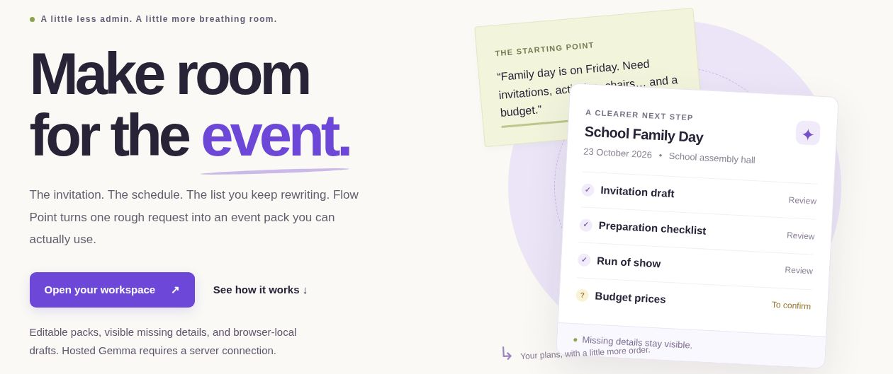

# Flow Point

**From a messy event request to a reviewed preparation pack.**

Flow Point helps organizers at schools, churches and community groups prepare an invitation, run of show, checklist and budget. Built by Paul Ayoade David ([PHONIEXz](https://github.com/PHONIEXz)) for Hacktoberfest 2026 Week 3, Slow and Steady.

**[Judge guide and fixed example](https://flowpoint.phoenixreborn.tech/judge)** · **[Live workspace](https://flowpoint.phoenixreborn.tech/workspace)** · **[Published DEV entry](https://dev.to/phoniexcryptz001/flow-point-one-messy-event-note-four-useful-drafts-and-the-questions-we-still-need-to-answer-3if8)**



## Watch the walkthroughs

| Video | Focus | Length |
| --- | --- | --- |
| [1. Create and navigate](https://youtu.be/xHEi4ybfHL0) | Home, Notes, consent and preparing a pack | 3:12 |
| [2. Update, review and export](https://youtu.be/m3PTH6_Rt2w) | Live update evidence, manual corrections, PDF and saved packs | 3:12 |
| [3. Tools and build evidence](https://youtu.be/p_Ob6AzwyVo) | Render, Gemma, .tech, GitHub, Copilot Chat, Node.js and PDFKit | 3:12 |

The three videos are embedded in different sections of the published entry. They combine edited interface motion, original instrumental music, captions and cursor emphasis. Earlier successful live runs and hand-authored sample sections are explicitly labelled; video pacing is not a speed benchmark. See [the media record](docs/media/README.md) and [demo guide](docs/demo-shot-list.md).

## Current status

**24 October status:** the interface now groups evidence, event details, review items, saved packs and exports into cards, with a working Home sample preview. There are 139 passing automated tests in the latest model-choice build. Chunk 1 adds spending-limit/allowance arithmetic, source-omission guards and programme-time checks. Frozen live evaluation and post-fix regression results are tracked in [Chunk 4](docs/chunk-4-current-run.md), with provider failures kept visible. A smaller community run revealed a clock-arithmetic issue now covered by validation. [UI checks](docs/ui-organization-2026-10-24.md) · [Chunk 1 results and limits](docs/chunk-1-verification.md). Chunk 2 adds exact source quotes, manual confirmation and stale-evidence checks; [its live results](docs/chunk-2-verification.md) retain the observed semantic failures.

The event workspace uses a full-page notes editor at `/workspace` and a preparation pack editor at `/workspace/pack`, with the AI update form beside the pack. A Node HTTP server and server-only Google Gemma and Groq GPT-OSS adapters support editing, open questions, deterministic checks, named browser-local Saved Packs, version approval, and PDF/Markdown/CSV downloads. There are no accounts, database, email sending or calendar writes.

**Earlier live inference and production deployment were verified on 23 October 2026.** A fictional event pack and a follow-up update were generated with `gemma-4-26b-a4b-it` on the deployed site. One provider HTTP 500 preceded the successful retry; the request was preserved. No API key is bundled. Without a configured server key the workspace explicitly disables live generation and offers a labelled, hand-authored sample. Provider errors never substitute sample output. Automated model tests use simulated HTTP responses; see the separate [live verification record](docs/verification.md).

## AI provider configuration

Groq: set `GROQ_API_KEY` on the server, optionally `AI_PROVIDER=groq` and `GROQ_MODEL=openai/gpt-oss-120b`. The server prefers Groq when its key exists unless AI_PROVIDER selects Google. Users can choose either configured provider in the shared Drafting model selector on Notes and the preparation pack. This changes only the next Prepare or Update, and the preference stays on that browser. Google remains available with `AI_PROVIDER=google`, `GEMINI_API_KEY` and optional `GEMMA_MODEL`. Keys are provider-specific and never sent to a different provider. The Groq adapter supports GPT-OSS 120B/20B with strict JSON schemas and the same semantic/review checks. Its free tier has request and token limits; a key does not guarantee capacity or reliability.

Processor consent is remembered separately for Google and Groq. Selecting a model restores that provider’s own saved permission; one provider’s permission never authorizes the other. A provider without its own saved permission requires a new consent choice; requests explicitly bind the selected provider and configured model; stale or unavailable choices fail without switching providers. Current provider/model appear in the workspace and generation evidence. Old videos and historical measurements remain labelled as the earlier implementation. No automatic cross-provider fallback is performed.

## Why we introduced Groq alongside Gemma

Google-hosted Gemma generation encountered intermittent HTTP 500 errors, timeouts and quota interruptions during development and evaluation. We added an alternative provider so users can select GPT-OSS through Groq when they prefer it, while keeping Gemma through Google available. Gemma is Google’s model; GPT-OSS is an OpenAI open-weight model served here by Groq, not the OpenAI API.

This is a choice between separately configured services, not a claim that Groq is always faster, more reliable or more accurate. Each has its own usage limits and may omit details. Both use the same validation, source-review, draft protection and export path. There is no automatic cross-provider retry. The current pack and its provenance remain unchanged when changing the selector; a successful generation records the actual provider/model used. See [model choice and provider rationale](docs/model-choice.md).

## Run

Requires Node.js 22.19.0 or newer (Node 24 recommended). Run `npm ci` to install the locked dependencies, including PDFKit and DejaVu fonts for PDF export. Hosted inference does not require a model download.

```sh
cp .env.example .env
# Add GROQ_API_KEY to .env using your editor, for live generation.
npm ci
npm test
npm run build
npm start
```

Open `http://localhost:3000/workspace`. Without a key, the sample still supports the full manual editing/review/export flow. `npm run demo` prints a hand-authored fixture; it is not inference evidence. `npm run dev -- --port 4173` supports preview supervisors after a build.

## Workflow

1. Describe your event and review the named processor and allow live processing.
2. Generate the pack with the configured open-weight model, or explicitly open the sample.
3. Compare extracted facts with the original request. Fill missing details, resolve questions and edit both drafts, tasks and prices. Refine with the configured model when you want the draft wording updated from new confirmations.
4. Review all sections and approve the exact version. Date/weekday conflicts, missing date, venue, start time, organizer, signatory, unresolved questions, confirmation placeholders and unknown prices block approval.
5. Download the preparation pack or budget worksheet. Draft downloads are allowed and marked as draft. The sample pack is labelled as sample data.

The current pack saves automatically in browser local storage. Name a pack in Saved Packs to keep it when starting another. Up to 12 named packs can be reopened, renamed and removed, and the previous single-draft format is migrated on first load. Named packs also save edits automatically. These browser copies are not synced across devices, encrypted by the app or backed up on a server. Browser storage may be cleared or fill up, so download a PDF or Markdown copy for backup. Editing a plan or its original request clears approval. Changing event facts does not silently rewrite the invitation: update the wording yourself or refine with the configured model.

Approval is a human review state, not authentication, permission to act externally or a guarantee of factual correctness. The server remembers approval fingerprints in a bounded in-memory cache. A restart or cache eviction may require renewed approval, while the browser-local draft remains. Export rechecks the fingerprint; a changed pack cannot inherit the previous approval.

## AI and validation boundary

The configured open-weight model interprets the request and proposes draft wording. It is instructed to keep unknown facts null and use confirmation placeholders. Code validates the returned structure, dates, quantities, integer money arithmetic and export safety before accepting a result. Those checks cannot prove that extracted facts match the original text; human review is essential. Suggested checklist items and run-of-show entries are proposals, not completed work.

Budget editing currently uses currencies with 100 minor units (for example NGN, USD, GBP and EUR). Enter main units in the UI; the core stores integer minor units, such as kobo. Unknown prices remain blank, distinct from a confirmed zero. Currency conversions and currencies with other minor-unit scales are not implemented.

Server safeguards include JSON/body limits, fixed static routes, same-origin browser checks, a restrictive CSP, model timeout and cancellation, sanitized provider errors, output validation and per-process concurrency/quota caps. The key is sent upstream in a header and never returned to the browser. Quota caps are per instance, not distributed rate limiting; this MVP is not a multi-user production security architecture. Do not paste private attendee data into live requests.

## Deploy on Render

`render.yaml` now describes a **Node Web Service** called `flow-point-app`, with `npm ci && npm test && npm run build`, `npm start` and `/healthz` declared in the Blueprint. The server binds `0.0.0.0` and honors `PORT`. A Static Site alone cannot run the API.

The Node service runs on Render with `GEMINI_API_KEY` set privately in its environment. The free service may sleep between visits. The live custom domain was opened over HTTPS during verification.

Live address: [flowpoint.phoenixreborn.tech](https://flowpoint.phoenixreborn.tech/). See [domain setup](docs/domain-setup.md).

## Verification

`npm test` covers date conflicts and invalid dates, exact budget arithmetic and overflow, missing facts, placeholders, approval invalidation, CSV escaping, and HTTP routes through generation, review, approval and export. Provider tests simulate valid, truncated, malformed, quota and network-failure responses. See [verification record](docs/verification.md) for remaining gates.

The HTTP service uses Node.js; PDF export uses PDFKit with bundled DejaVu fonts. eve was considered in the initial design but is not installed or claimed as part of the running app.

## Competition evidence

Challenge: https://dev.to/challenges/hacktoberfest-week3-2026-10-19

The [published DEV entry](https://dev.to/phoniexcryptz001/flow-point-one-messy-event-note-four-useful-drafts-and-the-questions-we-still-need-to-answer-3if8) contains three video embeds and fresh UI captures. Original PNGs are in [`docs/media/current/`](docs/media/current/). Its [Markdown source](docs/dev-submission-draft.md), [media provenance](docs/media/README.md) and [winner comparison](docs/submission-review.md) record the evidence and presentation choices.

Earlier implementation and recordings used Gemma. The current runtime supports Groq GPT-OSS as an alternative; partner-category claims must match actual use. Render, .tech Domain and GitHub Copilot credits remain subject to eligibility. [Copilot Chat's evaluated contribution](docs/copilot-review.md) covers PDF download filenames; it was not a registered formal PR review.

Earlier live generation, refinement and draft PDF export were checked. Later recording and screenshot attempts also encountered timeouts and Google HTTP 500, so inference availability is not consistently verified. The latest UI screenshots use a labelled, manually edited School Family Day sample; they are not new model-output evidence. The author reported successful phone use and a successful later school-event retest; see the chronological [verification record](docs/verification.md).

The 139-test automated suite passed in the latest app verification. Remaining measurement work: a timed manual-writing baseline plus review/export effort. The author's approximately 37-second preparation and 53-second update timings are operation timings, not a measured time-saving percentage. Record any changes made after the deadline.

## License

MIT. Copyright (c) 2026 Paul Ayoade David. Upstream models and services retain their own licenses and terms.

The [23 October repository review](docs/repo-review.md) records the latest fixes, automated checks and remaining limits.


Latest reliability check (24 October): the native structured-response path completed short Prepare/Update requests in 5.9/6.1 seconds on the first attempt. The detailed school-event replay still failed after upstream 503/500 errors and a fallback timeout. The 61 automated tests pass, but successful completion of detailed briefs remains an open limitation; see [the complete incident and live results](docs/verification.md#invalid-json-recovery-24-october-2026).


## Smaller generation steps and recovery (24 October)

The browser now prepares the pack through three separately validated calls: facts/checklist/budget, invitation, and run of show. Draft calls cannot change the checkpoint's structured facts. Completed responses are stored in the existing browser workspace; retries with identical notes, update text and previous plan reuse the successful prefix. Any input change starts fresh. The old pack is replaced only after all steps and a final server validation complete.

Each model step has a seven-minute server deadline shared by its bounded retries. The browser allows seven minutes and 15 seconds per step for transport overhead. With three sequential steps, a full pack can take up to about 21 minutes; you can cancel at any time. Three requests can use more provider quota than a single call. Checkpoints require available browser storage and do not recover responses lost before receipt. This is browser-local recovery, not a durable server queue or an exactly-once billing guarantee. Model/provider failures remain possible.

The [judge guide](docs/judge-guide.md) includes a small repeatable brief and expected initial NGN 4,000 subtotal / updated NGN 6,000 total. The original detailed school brief remains a separate regression case. `node scripts/benchmark-live.mjs --live --site https://flowpoint.phoenixreborn.tech --repeats 2` records every attempted hosted run, per-step references, timings and fact checks. It is excluded from tests and builds. Live results are recorded separately from the simulated-provider/unit/UI tests. Human review and a manual-writing baseline remain unmeasured.

First staged live measurement: the fixed judge brief prepared in 18.606 seconds and updated in 13.394 seconds, passing the listed budget/date/venue checks. The next attempt hit Google quota at its invitation step, and the runner stopped. Two completed out of three attempted operations is an interrupted small sample, not proof of overall reliability. [Raw measurement record](docs/evidence/staged-live-2026-10-24.json). The detailed-school staged regression was not reached in that batch.

Home now provides separate sample PDF and Markdown downloads. The two-page sample PDF is built from the same hand-authored fixture, clearly marked SAMPLE DATA / DRAFT, with unique download names. No model call is needed.

The [24 October competitor review](docs/competitor-review-2026-10-24.md) records a broad tag screening, selected article/source inspection, specific strengths and limits, and a prioritized Flow Point roadmap. Its comparisons concern published evidence and inspected code, not independently rerun competitor benchmarks.

The next implementation sequence is tracked in [Project update chunks](docs/update-chunks.md), with goals, dependencies and completion checks. Chunk 1 addresses known content omissions before source-linked review, update comparison and broader evaluation.

Update comparison keeps one previous browser-local version per pack. Compare changed facts, responsibilities, budget and full draft text; omitted open questions remain open until explicitly resolved. Restore swaps the two versions and clears approval and source confirmations. See [Chunk 3 verification](docs/chunk-3-verification.md).

Each Invitation, Run of show, Checklist and Budget tab also has its own PDF download. Individual PDFs keep the exact event title, natural document name, current review status and a unique download suffix. Full-pack PDF/Markdown and budget CSV downloads remain available. [PDF checks](docs/individual-pdfs-2026-10-24.md).

[Chunk 4 quality evaluation](docs/chunk-4-verification.md) freezes ten paired cases and preserves raw replies/failures. The first run stopped on Google quota after three attempted operations: one complete initial pack, two failures, seventeen skips. None of the six fresh cases ran. The one returned pack still omitted requested after-event checklist work, and a proposed-venue field mismatch needs semantic adjudication. This is an interrupted evaluation, not a reliability percentage.
