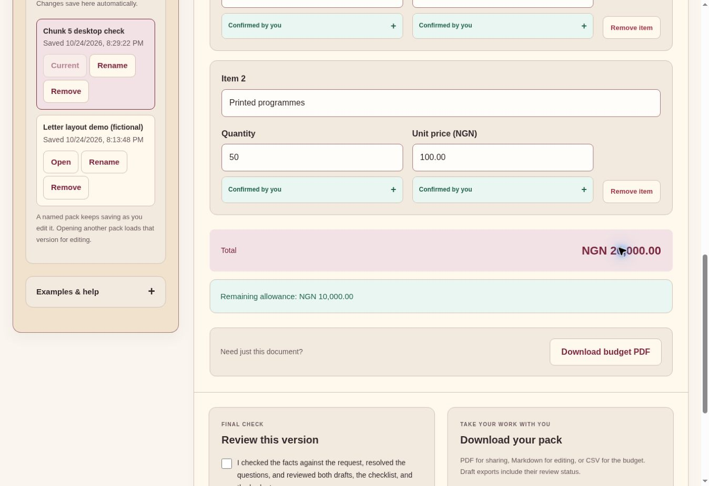

# Chunk 5: desktop verification and real-phone handoff

24 October 2026. Status: independent desktop subset checked; real-phone and human-effort results pending. Chunk 4 remains blocked by Groq daily quota. No general usability, mobile success or time-savings claim is made.

A separate named browser pack, Chunk 5 desktop check, was manually edited from the hand-authored sample. The existing Letter layout demo was preserved. No AI generation was requested by this UI workflow. The fictional brief was Chunk 5 School Day, Cedar Learning Centre, Saturday 14 November 2026, 10:00, Cedar Hall, signer Ada Cole/Coordinator. Programme durations were 10/20/30/10 minutes. Two budget rows had 50 refreshments at NGN 300 and 50 programmes at NGN 100; NGN 30,000 limit.

Observed on the live desktop browser:
- Notes/pack and all five editor tabs were usable. Facts and draft wording could be edited manually and letter layout applied without a model call.
- Unknown prices stayed incomplete until entered. Final total was NGN 20,000 and remaining allowance NGN 10,000.
- Sample owners and dates could be cleared instead of inherited as unsupported assignments.
- Source confirmation and explicit resolution of answered questions led to Ready for your final review. Approval remained unavailable before review, then the fully reviewed fictional version was approved.
- Full-pack PDF and budget CSV download events fired. Remote browser download paths were unavailable for filesystem readback in this environment, as in the preceding letter checks; no claim is made here that these files were opened on a real device. Previous live export byte/text checks remain in the letter evidence.
- Reload retained the named pack, title, 10:00 time, budget values and approved state on the same running server.
- Editing the venue cleared approval and the final-review checkbox; approval stayed disabled. Returning the venue to its original value did not silently reuse approval. The test copy remains a draft requiring that source review.

No new implementation defect was established by these checks. Rapid scripted clicks immediately after layout changes sometimes needed a fresh target observation/retry; this is not presented as a measured human usability failure. No physical phone was emulated or tested. Current live Prepare/Update and Restore could not be newly exercised because of quota; historical browser checks and simulated-provider tests are separate evidence. No human review/correction duration or manual-writing baseline was collected. Agent operation time is not human effort.

The [real-phone check](chunk-5-phone-check.md) is ready for the owner. Record phone/browser, readability, actual file opening, saved-value persistence and elapsed time only if measured. Leave blocked or unperformed steps visible. There are still 139 passing software tests from the unchanged deployed release; this verification did not rerun or replace those tests.

