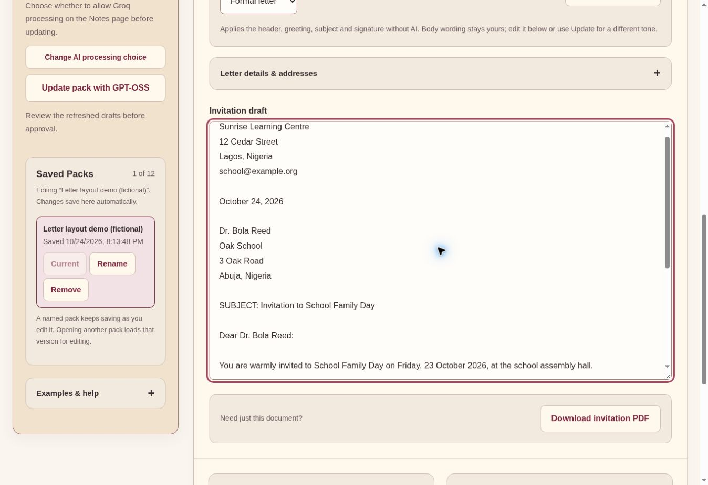

# Formal and informal block letters

Implemented from the owner’s supplied reference on 24 October 2026. Formal layout uses a left-aligned sender/contact block, separately chosen letter date, recipient name/organization/address, SUBJECT before salutation, preserved body paragraphs, standard closing, typed name/role, optional physical signing line and enclosures. Informal layout uses optional location/date, a first-name greeting, preserved conversational body, friendly closing, short signature and optional P.S. It omits subject and recipient address.

Open Invitation, choose Letter style, expand Letter details & addresses, fill known details and click Apply letter layout. Optional missing contacts are omitted, never invented. The separate letter date is not inferred from the event date. Fields save in the current/named browser workspace and survive Update and Restore. Applying changes clears approval. Metadata edits alone do not rewrite an already approved letter; Apply or an explicit AI update commits them into the draft. No AI call is needed to apply a layout. Contact details become part of the formatted invitation; a later explicitly consented AI Update may send that current invitation to the chosen provider. Local formatting preserves body wording; it does not claim to rewrite tone. Fresh successful Prepare/Update operations apply the selected layout after generation and before final review. Provider-specific permissions remain intact.

The standalone invitation PDF now begins with the letter rather than a large dashboard-like heading. It uses left-aligned 11-point body text, compact contact lines, bold formal subject and a review-status/page footer. Full-pack exports keep their normal event/review sections. Filenames still use the event title and a unique suffix.

Validation: 139 software tests passed, including complete block order, independent letter/event dates, informal omission, P.S., repeated application without duplicate signatures, physical signing line, missing/invalid details, body preservation, oversized-composition rejection, reload/named save, Update/Restore and approval invalidation. Two fictional single-page PDFs were generated through the actual PDFKit exporter, text-checked and visually inspected at 1100px. They were local fixtures, not live AI results. Live generation remains untested for this change because the prior run exhausted Groq daily quota and Google returned HTTP 500. Existing frozen evaluations remain unchanged; a new pending freeze is required for the changed runtime.

Deployed code: f6b6a2f5bf1d3bba98e18451b911db1b36b39f5f. Render deploy dep-dbeg4867bikc738bdkq0 reached live. Desktop browser checks verified both styles, formal-only/informal-only fields, local Apply, both PDF download events and named-pack restoration of letter date, recipient and closing after reload. Two direct live export requests returned HTTP 200 PDFs with the expected content and unique event-title filenames; see evidence/letter-block-2026-10-24/live-downloads.json. The browser’s remote download paths were unavailable for filesystem readback, so direct HTTP responses provided byte/text verification. No AI generation was requested. The current five-operation pending quality freeze is v7; it includes the same local formatter before application scoring/export.

