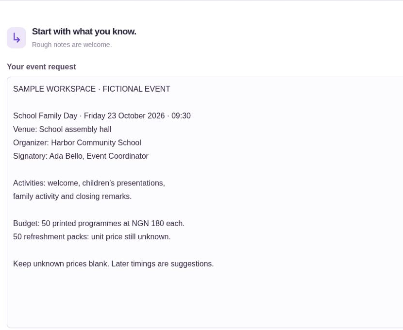
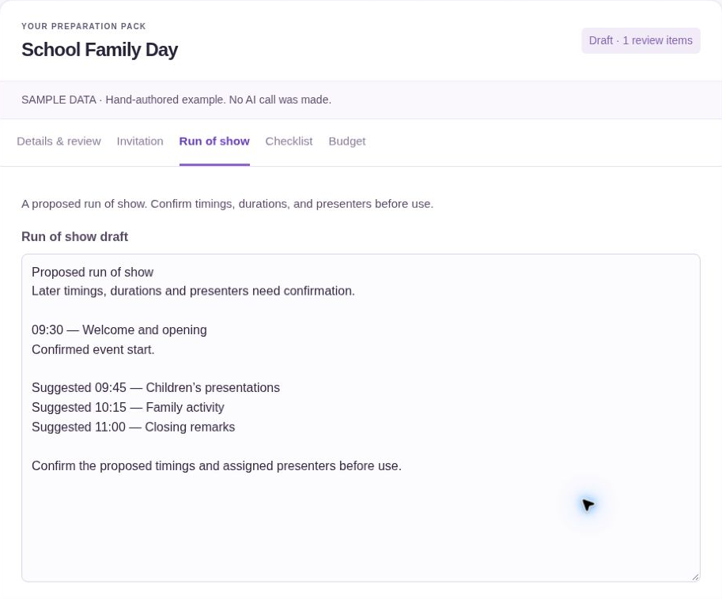
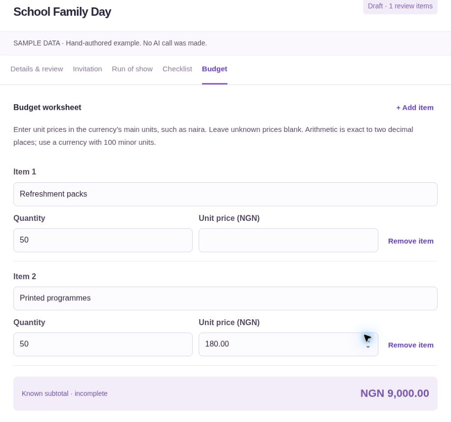

# Flow Point media record

Refreshed on 23 October 2026. These original PNGs are cropped at native resolution, with no enlargement, text replacement or invented interface elements. The published DEV article uses uploaded copies and provides full-size links because its inline image proxy scales previews.

## Current images

| File | Native pixels | Content |
| --- | --- | --- |
| [cover.png](current/cover.png) | 1260 × 529 | Current Home-page hero |
| [notes.png](current/notes.png) | 830 × 680 | Notes close-up with a fictional School Family Day brief |
| [schedule.png](current/schedule.png) | 913 × 758 | Manually edited sample: confirmed 09:30 start, later times suggested |
| [budget.png](current/budget.png) | 913 × 854 | Manually edited sample: unknown refreshment price, NGN 9,000 incomplete subtotal |

The Notes, schedule and budget captures use the app's labelled, hand-authored sample, with fictional manual confirmations. They are not evidence of a new Gemma response. A fresh generation attempt returned Google HTTP 500, so sample content was not represented as successful inference. The sample remains a draft. The NGN 9,000 subtotal is separate from the earlier Community Repair Day live pack's NGN 24,000 subtotal.

### Notes

### Schedule

### Budget

## Earlier live captures

The older `notes.jpg`, `schedule.jpg` and `budget.jpg` files in this directory are retained as earlier Community Repair Day live-run evidence. They are not the current article screenshots. See [verification](../verification.md) for the distinction between live inference, sample editing and automated simulated-provider tests.

## Videos

1. [Create and navigate](https://youtu.be/xHEi4ybfHL0), 3:12.
2. [Update, review and export](https://youtu.be/m3PTH6_Rt2w), 3:12.
3. [Tools and build evidence](https://youtu.be/p_Ob6AzwyVo), 3:12.

The films combine edited actual interaction capture, earlier live evidence and labelled explanatory panels. They use an original instrumental soundtrack. See [the demo guide](../demo-shot-list.md) for evidence and playback-verification limits.
