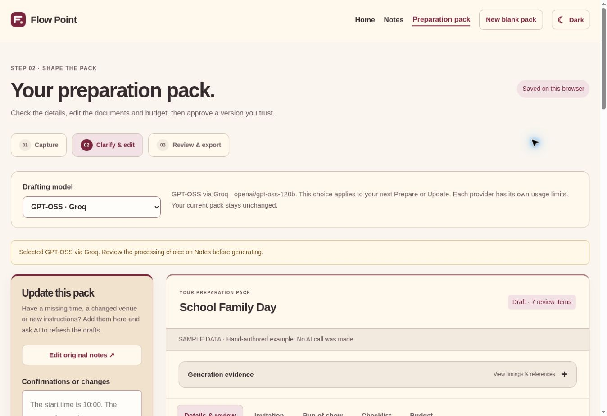

# Choosing Gemma or GPT-OSS

The shared Drafting model control is visible on both Notes and Preparation pack. Choose Gemma via Google or GPT-OSS via Groq. The choice applies to the next Prepare/Update, is remembered on this browser, and is locked while an operation runs. Switching alone never rewrites, approves or replaces the current pack. Existing model/provenance records remain historical. Available models are determined by separately configured server keys; missing providers are shown as not connected.

## Why Groq was introduced

During development Google-hosted Gemma produced intermittent HTTP 500s, timeouts and quota interruptions, including failed updates after retries. Groq was added to reduce dependence on one provider and offer GPT-OSS as another open-weight model. Gemma was retained. A newly configured Google key later passed small 26B requests but a 31B probe timed out; those basic probes were not full event-pack quality tests. Some failed packs also exposed application validation bugs, which were fixed separately. Adding a provider does not repair those bugs or guarantee extraction accuracy. There is no general claim that Groq is superior.

| Choice | Model family | API processor |
| --- | --- | --- |
| Gemma | Google Gemma | Google Gemini API |
| GPT-OSS | OpenAI GPT-OSS, open weights | Groq |

The GPT-OSS choice does not use the OpenAI API. Both providers run on the server with independent keys, limits and availability. Their separate request formats feed the same structure/content checks, source review, saved-prefix protection, review/approval and exports. Generation evidence records the actual model used; within-Google fallback may change the exact Gemma model and is disclosed in step receipts. Cross-provider fallback never happens automatically.

## Consent and saved work

Permission is saved separately for Google and Groq. A switch restores only the chosen provider’s own prior choice; otherwise it asks for consent on Notes. Remember my choice applies to that provider. Each request names the provider and current configured model. Unknown, unavailable or stale model choices fail safely before dispatch; one API key is never sent to the other service. Cached partial generation includes provider/model identity, preventing reuse across choices. The previous complete pack remains intact on error or cancellation.

Earlier videos and the public article describe the previous Google implementation. They remain historical until the presentation refresh; this change updates repository documentation and the judge guide, not those external publications. Both options still require human checking. A JSON response, an exact-match scorecard or a small demo does not guarantee that every fact is correct.

## Requested venue versus booking approval

The venue field retains a single named requested/proposed location. A location name alone does not mean a room is booked. A pending booking remains an open question and drafts must label it proposed. No venue is invented when none is supplied. Earlier evaluations sometimes returned null for a proposed but unapproved location; those frozen mismatches remain in their original records. The clarified contract preserves the supplied location and its separate approval question.

## Deployment verification, 24 October 2026

Code `2ba1026f15d85035eeab873282d56c0b684c5d80` deployed through Render `dep-dbefif7b9u1s739iak60`. All 130 software tests passed. Desktop browser checks exercised both options, preference restoration after reload, separate remembered permission and unchanged sample-pack content after switching. Test permission was revoked after this check. No real attendee data was used.

A fictional Cedar Reading Meetup Google Prepare reached the selected Gemma adapter but failed in its facts step: the application returned HTTP 502 for upstream Google HTTP 500 after bounded retries, reference `8e4fcf2f-4029-406e-a233-e5ee78105901`. The recorded request and response are in `docs/evidence/model-choice-2026-10-24/google-choice.json`. No cross-provider fallback occurred. Google being configured means its key exists, not that every generation will succeed. The Groq pack-quality retests are recorded separately.

The follow-up correction build is `0bba82442b9a48874534a828914fbd5bd9edd35f`, with **133 passing software tests**. It retains the same selector. v5 completed ten of eleven Groq operations before daily quota stopped the final community Update. Five further regression operations are frozen but not executed; [Chunk 4 remains open](chunk-4-current-run.md). No quota-bypass inference was attempted.

This screenshot demonstrates the selector and layout, not a new live model generation.
